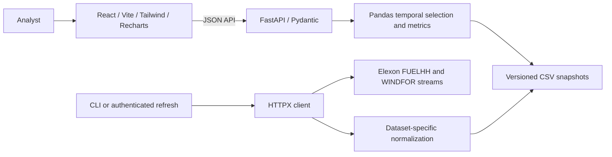

# WindMarket Intelligence

A UK national wind forecast evaluation workspace for power traders and procurement analysts. It reconstructs the latest **retained** WINDFOR forecast eligible at a simulated decision time, aligns it with FUELHH WIND outturn, and quantifies uncertainty without introducing prices, weather feeds or invented demand.

**Current local status:** the redesigned frontend builds successfully; 8 frontend tests and 31 backend tests pass. The UI uses Apple-inspired system typography, a light sidebar, white panels and native-style controls. Elexon's official OpenAPI URL has been corrected and its publication parameters reviewed. No January snapshot has been acquired in this restricted session, and live-browser, Docker and public deployment verification remain pending.

For local development, stop existing frontend/backend processes, then run from repository root:

```sh
./scripts/dev.sh
```

Open http://localhost:5173. The launcher starts both services, loads official January data in the background if no snapshot exists, and enables a loopback-only **Load Elexon data** action. Download progress/failures appear in the UI; successful acquisition updates it automatically. Ctrl+C stops both services. The initial acquisition may take several minutes. The local refresh endpoint is disabled in production by default.


## Features

- Five analytical views: overview, forecast explorer, accuracy analysis, procurement scenario, and data quality/methodology.
- January-only delivery dates, configurable D−1 cutoff, explicit timezone-aware decision override and clearly separate retrospective mode.
- 30-minute comparison, publication history, eligibility audit, sortable/paginated ledger and CSV interval export.
- MAE, RMSE, signed bias, WAPE, coverage, directional errors, daily trends, settlement-period and lead-time summaries.
- Demand scenarios using user input and backend-selected wind forecasts; no procurement orders or market prices.
- Token-protected refresh, bounded HTTP requests, retries, deterministic normalization, quality counters and atomic CSV snapshots.
- Dark responsive JSX interface, loading/error/empty states, keyboard-operable controls, Recharts and Lucide.

## Architecture



Python 3.12, FastAPI, Pydantic, Pandas, HTTPX, Pytest and Uvicorn form the backend. The frontend uses React, Vite, JavaScript JSX, Tailwind CSS, Recharts and Lucide React. Docker Compose runs Nginx and a separate backend service. CSV keeps acquisition transparent and reproducible; a small in-process snapshot cache reloads only when the atomic snapshot pointer changes.

## Repository

```text
backend/
  app/config.py          Environment configuration and scope assumptions
  app/source.py          HTTPX, schema gate, publication-window chunking
  app/normalization.py   Separate WIND actual and forecast parsers
  app/storage.py         Snapshot loading, atomic writes, acquisition CLI
  app/analytics.py       Settlement grids, as-of selection, metrics, residuals
  app/main.py            REST routes, validation, auth, OpenAPI
  tests/                 Synthetic fixtures and backend tests
  requirements.txt       Pinned runtime and test dependencies
frontend/
  src/api.js             Fetching, cancellation and request states
  src/components.jsx     Shared panels, KPIs, charts and availability states
  src/main.jsx           Five application views and working controls
  src/style.css          Responsive design system and Tailwind entry
  src/components.test.jsx Frontend states/data-hook tests
  nginx.conf             Same-origin /api reverse proxy
  vercel.json            Vercel build configuration
compose.yaml             Local two-service setup with persistent data volume
render.yaml              Separate Docker backend and persistent disk blueprint
scripts/                 Release checks
data/                   Ignored snapshots; initially empty
docs/                   Methodology, validation, deployment and video handover
```

## Setup

Prerequisites: Docker Engine/Desktop with Compose, or Python 3.12 and Node 24 with npm. Internet access is needed to install dependencies and acquire Elexon data. No Elexon API key is required.

```sh
cp .env.example .env
docker compose up --build
```

Frontend: http://localhost:8080. Backend: http://localhost:8000. OpenAPI: http://localhost:8000/docs. Health: `curl --fail http://localhost:8000/api/health`.

The frontend proxies `/api` to the backend container. Health can be `ok` while data is `unavailable`: service health does not imply source coverage. No network request to Elexon is required at startup.

First acquire the official snapshot in another terminal:

```sh
docker compose exec backend python -m app.storage
```

Reload the dashboard using its reload control. Failed refreshes preserve the previous valid snapshot. The acquisition process exits nonzero with useful errors; no fixture fallback is available.

Without Docker, from repository root:

```sh
python3.12 -m venv .venv
.venv/bin/python -m pip install -r backend/requirements.txt
cd backend
DATA_DIR=../data ../.venv/bin/python -m app.storage
DATA_DIR=../data ../.venv/bin/python -m uvicorn app.main:app --host 127.0.0.1 --port 8000
```

In a second terminal, from repository root:

```sh
cd frontend
npm install
npm run dev
```

Vite serves http://localhost:5173 and proxies `/api` to `127.0.0.1:8000`. Set `API_PROXY` when the dev backend is elsewhere. The generated `frontend/package-lock.json` is now available. Use `npm ci` for clean installations; the frontend Dockerfile automatically selects it when the lockfile is present.

## Environment variables

| Variable | Purpose | Default |
|---|---|---|
| `DATA_DIR` | Backend snapshot directory | Repository `data/`, independent of working directory; `/data` in Docker |
| `CORS_ORIGINS` | Comma-separated exact frontend origins | localhost:5173 and localhost:8080 |
| `ADMIN_TOKEN` | Secret header value for remote refresh | Empty: remote refresh disabled |
| `DEFAULT_CUTOFF` | Valid `HH:MM` D−1 UK local cutoff | `09:20` |
| `VITE_API_BASE_URL` | Public backend HTTPS origin at frontend build time | Empty: same-origin proxy |
| `ENABLE_LOCAL_REFRESH` | Enable origin-checked, loopback-only local loading | `0`; local launcher uses `1` |
| `AUTO_REFRESH_ON_STARTUP` | Background acquisition when no snapshot exists | `0`; local launcher uses `1` |
| `API_PROXY` | Vite-only backend proxy target | http://127.0.0.1:8000 |

Never put `ADMIN_TOKEN` in a `VITE_` variable or commit `.env`. Production requires exact HTTPS CORS origins. Compose persists data in a named volume; removing that volume removes the cache. The Render blueprint requires a compatible plan with persistent disk. On ephemeral hosting, load an externally persisted snapshot on startup or reacquire it; this implementation does not pretend ephemeral disk is durable. Use one backend instance/worker and one refresh writer; the refresh lock is process-local.

## Official sources and acquisition status

- [FUELHH stream documentation](https://bmrs.elexon.co.uk/api-documentation/endpoint/datasets/FUELHH/stream): filter exactly `fuelType == WIND`; use `startTime` and `generation` in MW, and outturn publication timestamps when supplied.
- [WINDFOR stream documentation](https://bmrs.elexon.co.uk/api-documentation/endpoint/datasets/WINDFOR/stream): target `startTime`, forecast `publishTime`, `generation` in MW.
- [Elexon developer portal](https://developer.data.elexon.co.uk/) states that dataset queries by publication time can retrieve superseded data and that stream responses are JSON without the non-stream return limits. This supports using the raw WINDFOR dataset rather than its derived latest view.

**Verification limits:** the browser-readable official OpenAPI at [data.elexon.co.uk/swagger/v1/swagger.json](https://data.elexon.co.uk/swagger/v1/swagger.json), linked by [Elexon's platform documentation](https://github.com/elexon-data/insights-docs/blob/main/docs/insights_data_platform.md), was reviewed. It confirms both stream paths, `publishDateTimeFrom` / `publishDateTimeTo` parameters, JSON arrays, and the ability to supply WINDFOR publication filters instead of receiving only the latest forecast. The client now checks this correct schema URL before acquisition. The previous candidate URLs were incorrect. Representative January records, timestamp field behavior and coverage still cannot be verified here because this session's HTTP client cannot resolve the API host.

The schema gate checks query parameter names; it is not a substitute for reviewing field descriptions and representative records. Complete that review before relying on real-data results. No alternate dataset has been substituted. Source timestamps must have explicit offsets; naive source timestamps are rejected pending documentation review.

Acquisition is reproducible using `python -m app.storage` from `backend/`. It requests one-day publication chunks, with at most two concurrent requests, 10-second connection / 45-second operation timeouts, four attempts, exponential backoff, and bounded `Retry-After` handling for 429/selected 5xx responses. Non-transient errors fail immediately. Every failure is logged. Stream arrays are not paginated by the client; the schema/response must be verified before assuming that behavior for a changed API.

Publication acquisition windows (exclusive end): FUELHH 2026-01-01 through 2026-02-04; WINDFOR 2025-12-25 through 2026-02-02. Only January delivery intervals survive normalization. The December lookback supports January 1 day-ahead decisions; it cannot guarantee availability for arbitrary decisions before December 25. Outturn revisions after the acquisition window are not represented. “Actual” means latest retained outturn, not a guarantee of final settlement data.

Snapshots contain normalized `actuals.csv`, `forecasts.csv`, `metadata.json` and `source-openapi.json`. `current.json` points to one immutable snapshot directory and is atomically replaced only after both datasets are valid and nonempty. Provenance records successful refresh time, requested windows, source, invalid rows, duplicates, conflicting keys, interval counts and multiple-vintage interval counts. Large raw API responses are not committed. Synthetic observations exist only in tests.

## Temporal methodology

Delivery dates are **January 1–31, 2026 in Europe/London**, a total of 1,488 expected half-hours. UK local midnight boundaries are converted to UTC; joining uses the normalized UTC `startTime`. January is GMT. DST tests also verify 46/50-interval transition days outside the UI’s assignment scope.

The default decision is **09:20 UK local time on the preceding day**. This is a modelling assumption inspired by [EPEX’s documented GB hourly day-ahead timing](https://www.epexspot.com/en/news/exchange-council-welcomes-new-timing-gb-day-ahead-auction), not a claim about a particular desk or all auction products. Users can change the cutoff or enter a timezone-aware decision override; the UI labels its override as UTC/GMT because the target month is January. The API requires an explicit timezone offset.

For each target interval, filter `publishTime <= decisionTime`, select the largest eligible timestamp and left-join actual generation on UTC start. Preserve target, publication, decision, age at decision, lead time, signed/absolute/percentage error and quality status. Equality at the cutoff is eligible. Forecasts published after the decision are never eligible in decision mode. Forecast age is decision minus publication; lead time is target minus publication.

Retrospective mode separately selects the latest **retained** publication for each target, including publications unavailable at the original decision time. Its forecast age-at-decision is intentionally null. The mode is explicit in the UI/API/export and never pooled with decision-mode metrics. A custom decision timestamp constrains accuracy evaluation to one delivery date; without an override, each day receives its own D−1 cutoff.

WINDFOR keys are `(startTime, publishTime)`. Exact duplicates collapse. Conflicting generation at identical keys is excluded and counted; no arbitrary winning value is invented. FUELHH uses the same publication key when available, then retains the latest outturn per target. If actual publication metadata is absent, target time is used only as an internal deduplication fallback; revision ordering cannot then be established. Verify actual publication semantics before acquisition sign-off.

## Metrics and missing observations

Let F be selected forecast and A be actual MW. Every generation/error aggregate uses **matched valid pairs**, with a common exposed `sampleSize`. Forecast and actual averages therefore describe that same sample rather than different missing-data subsets.

| Measure | Definition |
|---|---|
| Signed error / bias contribution | F − A; positive is overforecast |
| Absolute error | \|F − A\| |
| Percentage error | 100 × (F − A) / A, null for A = 0 |
| MAE | mean(\|F − A\|) |
| RMSE | sqrt(mean((F − A)²)) |
| Mean bias error | mean(F − A) |
| WAPE | 100 × sum(\|F − A\|) / sum(\|A\|), null for zero denominator |
| Coverage | 100 × matched valid pairs / expected settlement intervals |

Maximum absolute error and over/under/exact interval counts also use matched pairs. WAPE exposes its denominator; individual percentage errors expose the nonzero-actual sample count. No MAPE is reported because low actuals can make it misleading. Missing counts can overlap; a missing-both interval contributes to each count. Invalid, missing, negative and non-finite generation never becomes zero. No interpolation fills gaps. Empty-sample metrics are null, except coverage and counts. Conflicting/invalid exclusions are recorded in snapshot metadata.

Positive wind bias can leave a larger actual residual requirement than anticipated; negative bias can lead to unnecessary planned purchases, all else equal. This is conditional reasoning, not measured business impact.

## Procurement scenario

Demand is always supplied by the user. Estimated residual = `max(0, estimated demand − eligible forecast wind)`. Actual-comparison residual = `max(0, actual demand − actual wind)`. When actual demand is omitted, the same supplied demand assumption is used for both and labelled accordingly. Residual error is estimated minus actual-comparison residual. Missing eligible wind produces HTTP 409, not an invented scenario.

This wind-only calculation excludes other generation, interconnectors, balancing actions, contractual positions and demand uncertainty. It is neither a full trading recommendation nor an order. No client identity, savings or operating outcomes are claimed.

## REST API

Interactive schemas: `/docs`. JSON routes:

| Route | Purpose |
|---|---|
| `GET /api/health` | Service and data availability |
| `GET /api/metadata` | Source links, refresh, quality, scope |
| `GET /api/overview` | Evaluated half-hours and sample-aware KPIs |
| `GET /api/forecasts` | Sorted/paginated settlement ledger |
| `GET /api/forecast-history` | Retained vintages with eligible/selected flags |
| `GET /api/accuracy` | Date-range, daily, time-of-day and lead-time summaries |
| `POST /api/scenarios/residual-procurement` | User demand scenario using backend-selected wind |
| `POST /api/local/refresh` | Local launcher only: loopback, trusted Origin, JSON and cooldown checks |
| `POST /api/admin/refresh` | Expensive acquisition; requires `X-Admin-Token` |

Common parameters: `delivery_date`, offset-aware `decision_time`, `cutoff=HH:MM`, `mode=decision|retrospective`. Accuracy adds `start_date` and `end_date`; history adds `settlement_period`. Ledger supports `sort`, `descending`, `page`, `page_size` and optional settlement-period filtering. Production errors hide internal exception details; server logs retain diagnostics.

## Validation

Executed with managed Python 3.12 and dependencies copied from the local package cache:

```sh
cd backend
../.venv/bin/python -m pytest -q
```

**31 passed**, one upstream Starlette warning about TestClient’s HTTPX compatibility. These tests cover both parsers, WIND filtering, invalid/missing/zero values, DST/timezones, exact cutoff eligibility, post-cutoff exclusion, joins, duplicates/conflicts, hand-calculated metrics, residuals, API validation, dashboard/scenario data flow, retry behavior, schema checks and atomic cache preservation. These are synthetic unit/in-process API tests, not proof of live January data or external HTTP service reachability.

Frontend verification was executed successfully:

```sh
cd frontend
npm test       # 8 tests passed
npm run build  # successful Vite production build
```

The frontend tests include loading/error/empty states, backend-driven KPIs, data fetching, and the local data-loading progress/failure flows. The production build separates React and chart dependencies into independent chunks. `docker compose config --quiet` previously passed; container build/start and browser-based visual checks remain unavailable in this session. No passing public deployment is claimed.

## Deployment and submission

**Selected hosting: Vercel frontend + Railway backend.** Follow [the Vercel/Railway guide](docs/vercel-railway.md) for root directories, variables, persistent volume setup and deployment logs. `backend/railway.json` and the PORT-aware `backend/start.sh` are ready. The older Render blueprint is an optional alternative.

See [exact deployment and publishing steps](docs/deployment.md). Frontend configuration targets Vercel; backend configuration targets a separate persistent-disk Docker service on Render. Set `VITE_API_BASE_URL` to the verified backend HTTPS origin before the frontend build and configure exact frontend `CORS_ORIGINS` on the backend. Never use production localhost. Load data into the backend’s durable `/data` volume and verify its metadata and representative calculations.

**Verified public frontend URL:** none. **Verified public backend URL:** none. **Public GitHub URL:** none. GitHub’s existing credentials are invalid. An anonymous repository name and publication commands are provided in the deployment guide. Source files contain no personal branding. The workspace prevents `.git` writes; a separate local repository is prepared under `/tmp` when permitted, as recorded in the handover. Temporary files are not durable—copy them before leaving this environment.

**Demo video:** no recording or upload was made. [Client/technical script](docs/demo-script.md), [technical walkthrough](docs/technical-walkthrough.md) and [recording checklist](docs/recording-checklist.md) are ready. Record only after source acquisition and runtime validation; if those remain blocked, explicitly show the unavailable state instead of substituting synthetic observations.

## AI disclosure and acknowledgements

OpenAI Codex was used to assist with application implementation, source-document research, quantitative methodology, test creation/execution, design and documentation. Human review and the remaining live-data/deployment validation are still needed. AI assistance does not establish source correctness or production readiness.

Data and definitions are acknowledged to Elexon Insights/BMRS; market timing context to EPEX SPOT. Follow [Elexon’s developer portal terms and data licence references](https://developer.data.elexon.co.uk/) before redistributing snapshots. No raw data licence is superseded by this repository. No separate open-source licence has been asserted on the user’s behalf.
